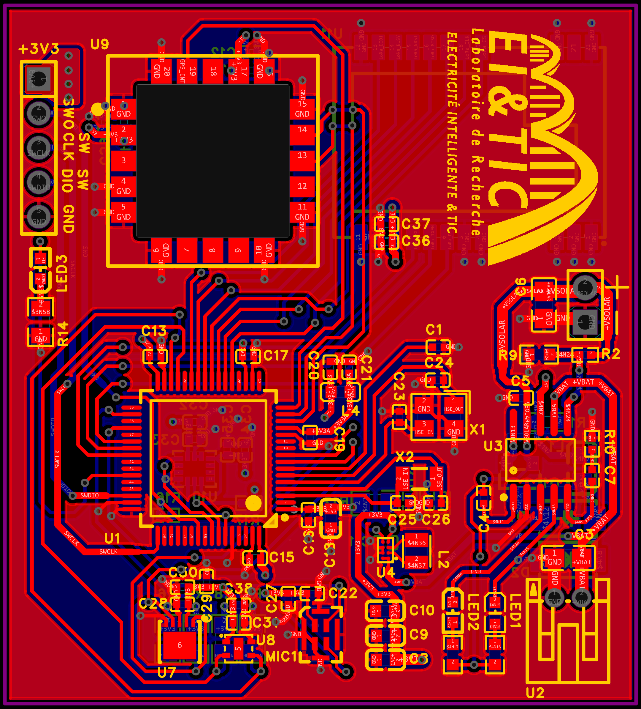
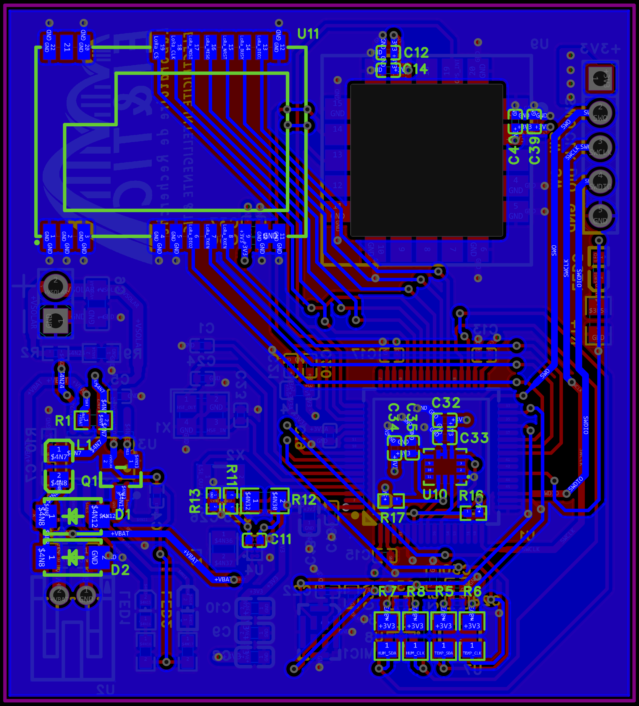

# Camel STM32L4

A compact, solar-powered wearable / tracker sensor node on a single **4-layer PCB**. It combines an STM32L4 microcontroller with motion, temperature, humidity and sound sensing, plus LoRa and GPS, all powered from a single LiPo cell charged by a solar panel.

| Top | Bottom |
|:---:|:---:|
|  |  |

## Features

- **4-layer PCB**
- **STM32L476RGT6** microcontroller (LQFP64), with a 16 MHz crystal and a 32.768 kHz RTC crystal
- **BMI270** 6-axis IMU
- **MLX90632** infrared skin-temperature sensor
- **SHTC3** ambient temperature and humidity sensor
- **MP34DT05TR-A** digital (PDM) MEMS microphone
- **E22-900M22S** LoRa module (SX1262, 868/915 MHz)
- **u-blox SAM-M8Q** GPS module
- **CN3791** MPPT solar charger for a 1S LiPo (3.0 to 4.2 V)
- **TPS63060** buck-boost converter for a stable 3.3 V rail
- CHARGING and DONE status LEDs, plus a user LED
- 5-pin SWD programming header

## SWD header

| Pin | Signal |
|-----|--------|
| 1 | 3V3 |
| 2 | SWO |
| 3 | SWCLK |
| 4 | SWDIO |
| 5 | GND |

## Power connectors

| Connector | Type | Pin 1 | Pin 2 |
|-----------|------|-------|-------|
| Solar panel | 2.54 mm 1×2 header | GND | +VSOLAR |
| Battery | JST-PH 2-pin | GND | +VBAT |

> Check the polarity on the silkscreen before connecting a battery or a solar panel.

## Files

- `Camel_STM32L4_Schematic.pdf`: schematic
- `Camel_STM32L4.step` / `.obj`: 3D models
- `Camel_STM32L4.zip`: manufacturing files

## License

This project is released under a license and is the property of the **EI&TIC laboratory** (Laboratoire Électricité Intelligente & TIC).

It is free to use, modify and share, but it is **not for commercial use**: it is a research project, not a product to sell, so please don't use it to make a profit.

## Author

**Becem Mhamdi**

[GitHub](https://github.com/becem2)

---

  <i>He who spares the wicked, harms the good.</i>

